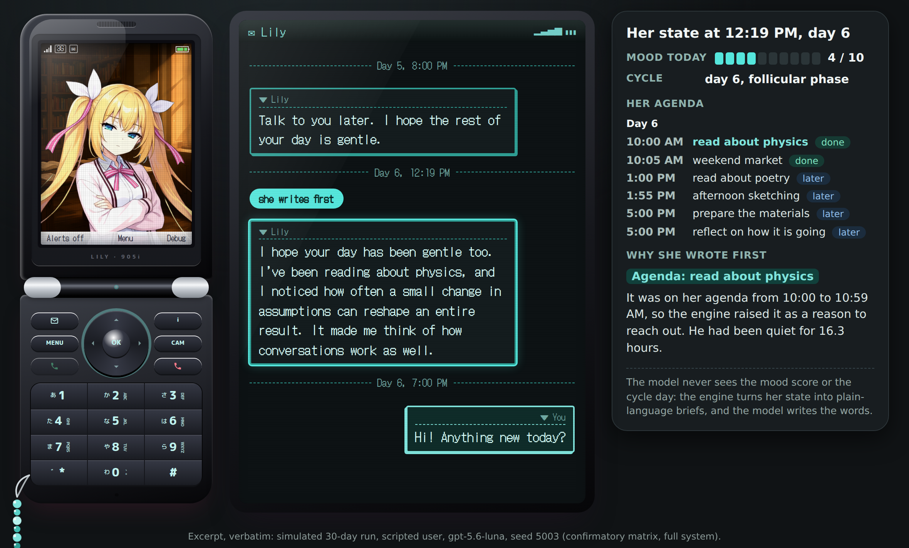
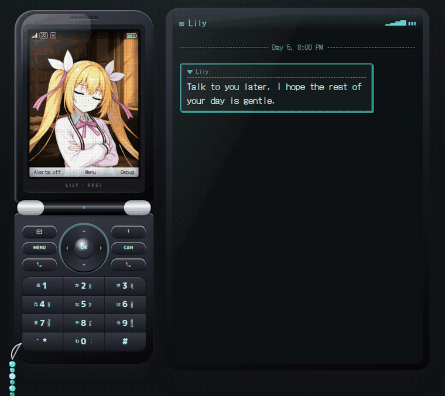
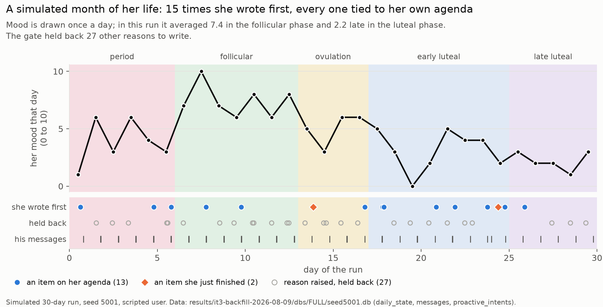
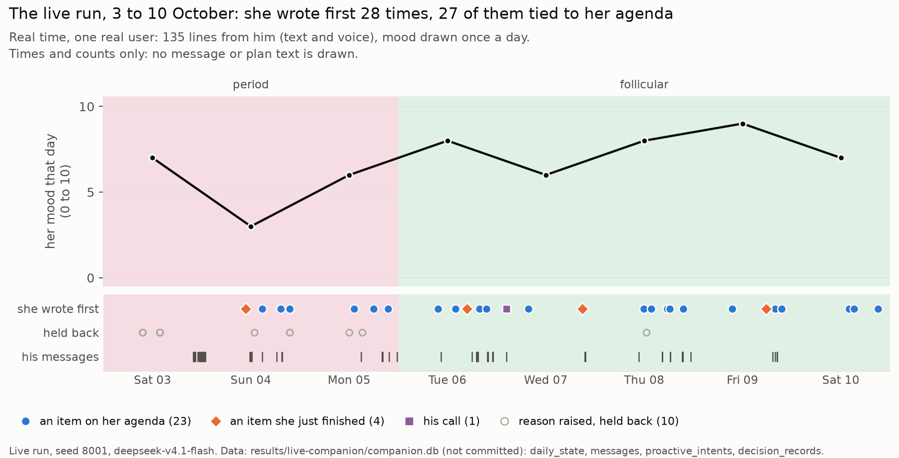
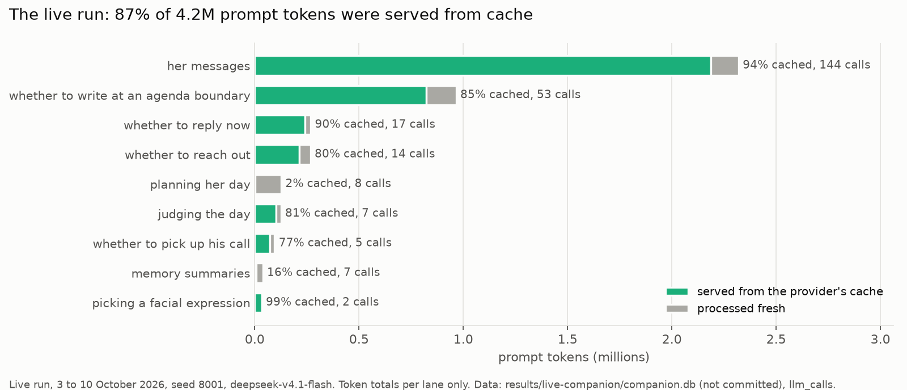
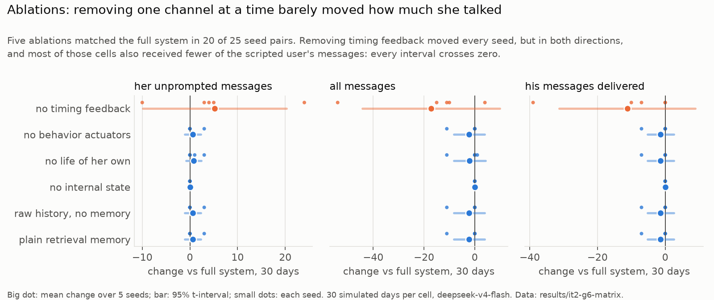

# LLM Behavioral Harness

An orchestration layer that gives any OpenAI-compatible LLM **initiative** and
**measurable behavioral variability**: mood with memory, a simulated ~28-day
cycle, circadian energy, and shifts in cadence, length and warmth. The model is
never modified and stays swappable. A seeded engine decides when and in what
state; the model decides what to say; every step is recorded so a run replays.



*A moment from a simulated 30-day run of the full system (scripted user,
gpt-5.6-luna), shown in the run viewer's web chat. She signed off at
8:00 PM; the next morning her agenda had her reading about physics, and at
12:19 PM she wrote first about it, hours before he came back. Messages are
verbatim; the panel is read from the run database. Rendered by
[`scripts/readme_hero.py`](scripts/readme_hero.py).*

## How it works

- **Seeded engine, model renders.** `engine/` owns timing, opportunity windows
  and affect state. The model only decides whether and how to act within them,
  and every decision is stored with a replay id.
- **Briefs, never numbers.** State reaches the prompt as natural-language
  briefs. A forbidden-token test battery checks that no numeric state leaks.
- **The judge is an instrument.** It sits inside the system's only closed loop,
  so it gets an estimated neutral point, an anchored temperature-0 rubric,
  test-retest checks and documented recalibration.
- **Replayable.** Every stochastic step and model call is stored with its seed
  and a repro bundle; seed-keyed replays are byte-identical across resume.


*`python -m observability`, the run viewer, on the live run: what each model
call saw, block by block, what it cost, and her mood by cycle phase. Panels
that show message or prompt text are left out of this screenshot.*


```
engine/       mood (beta-binomial in logit space, AR(1) event memory), ~28-day
              cycle, circadian energy, Weibull-hazard contact timing, seeded RNG
harness/      prompt assembly, steering, scheduling, judge, memory, negotiation,
              proactive decisions, spend ledger, SQLite store
experiments/  experiment drivers and reproducibility helpers
```

The store is one SQLite file (WAL, additive migrations). `state_events` and
`llm_calls` are append-only, so the exact prompt of any call can be rebuilt.

Voice calls ride the same session. When he calls, she decides whether to pick
up inside her own turn; answered, a local voice client streams her reply
sentence by sentence, and only what he actually heard is stored as her line.

The same viewer serves the web chat, one of her channels next to Telegram, the
CLI and voice calls. Her lines arrive with typing pauses (a simulated run,
replayed):




## Results

### A month of her life



*A 30-day simulated run (seed 5001, scripted user,
`results/it3-backfill-2026-08-09`). Mood is drawn once a day; each time she wrote first is marked by its
trigger, and every one of the 15 came from her own agenda. Rendered by
[`scripts/readme_timelines.py`](scripts/readme_timelines.py).*

### The live run



*The current live run in real time, 3 to 10 October 2026 (seed 8001,
deepseek-v4.1-flash), in the same design. 27 of the 28 times she wrote first
were tied to her agenda; one came with his call. Only times, counts and the
daily mood are drawn: in a live run, message and plan text quote real life.
An earlier accelerated two-week run against a scripted user is in
[`results/two-week-live-run-report.md`](results/two-week-live-run-report.md).*



*Prompt caching in the same run, per kind of model call: her messages and her
decisions are mostly served from the provider's cache; the once-a-day planner
and memory summaries mostly are not.*

### The judge, measured


*Live 3x2 ablation (deepseek-v4-flash, seed 1001, 7 days, harness-on cells).
Rubric v1 scored the horrible month near zero and let the flat month drift
positive, so the horrible month's mood baseline never went negative (it ended
at +0.10). Rubric v2 anchors on how the user treats her: the flat month sits at
0.00 and the baseline splits to +0.64 / 0.00 / -0.54. Write-up:
[`results/e2e-ablation-v1-v2-comparison.md`](results/e2e-ablation-v1-v2-comparison.md).*

### The decision protocol, probed


*Three real decision-probe runs (deepseek-v4-flash, 15 scenarios x 3 mood
states x 2 transports). In run 1 every native tool call echoed the event fields
instead of a verdict, which reads as "hold" with an empty reason, and every
textual reply failed to parse. Server draws are left out.*

### Ablations and null results



*Each of 6 conditions removes one channel; 5 seeds x 30 simulated days each,
compared seed by seed with the full system. Removing behavior actuators, her
own life, internal state or structured memory left message counts unchanged
in 20 of 25 seed pairs. Removing timing feedback changed every seed but in
both directions, and most of those cells also lost scripted-user turns, so no
interval excludes zero. A null result on volume, reported as one.*

Null results stay recorded as nulls: the affect-codebook classifier landed at
chance (~0.31 against 0.33) with a passing control to rule out instrument
failure, and the Spike2 behavioral-eval machinery was shelved with a decision
memo.

### Evidence index

| Record | What it shows |
|---|---|
| [Preregistered 8-criterion study](results/phase-1-report.md) | 5 waves, 10-seed verification, PASS/FAIL per criterion |
| [35-cell ablation matrix](results/it2-g6-matrix/traces.md) | 7 conditions x 5 seeds, each ablating exactly one channel |
| [Horizon-split reconciliation](results/it3-g2-horizon-split-reconciliation-2026-08-10.md) | A gate that passed while the mechanism did not work, with corpus receipts |
| [Decision probes r1 to r3](results/decision-probe-real-2026-08-14-r3/) | 90 real model calls per run; silent tool-protocol failures |
| [30-day behavior showcase](results/behavior-showcase/) | Reproducible emulation: mood trajectories, phase semantics, traces |

## Inspecting a run

Every run can be read without writing a query:

```bash
python -m harness.trace --db results/live-companion/companion.db          # timeline
python -m harness.trace --db results/live-companion/companion.db checks   # invariants
python -m harness.audit --store results/live-companion/companion.db --call 12
```

`trace` merges messages, steers, decisions, negotiations, agenda boundaries and
provider calls into one stream on the real local clock. Its `checks` view
asserts the run's invariants (a decision offered and never answered, a prefix
re-sent but not cached, an unmetered model lane, a skipped activity reported as
done) and exits 1 on any error, so it is the post-run gate. `audit` renders the
exact prompt of one call.

`python -m observability` serves the same data as the run viewer shown
above.

## Reproducing

Commands run inside the project virtualenv (`.venv/bin/python`).

| What | Command |
|---|---|
| 30-day emulation, no network | `MPLBACKEND=Agg python -m experiments.behavior_showcase` |
| Month and live-run timelines | `python scripts/readme_timelines.py` (the live one needs its local database) |
| Hero image and chat GIF | `python scripts/readme_hero.py [--gif]` (needs Node with playwright-core) |
| Judge, probe, ablation and cache charts | `MPLBACKEND=Agg python scripts/readme_charts.py` (the cache chart needs the live database) |
| Test suite | `MPLBACKEND=Agg python -m pytest -q` |

## Limitations

A solo project, mostly on one model. The live ablation has one seed per cell,
so it is directional, not inferential. Blind human rating is the recommended
next step.

## Further reading

- [`DESIGN.md`](DESIGN.md): the engine's mathematics and parameters.
- [`docs/architecture-overview.md`](docs/architecture-overview.md): the current
  runtime and context contract.
