# LLM Behavioral Harness

An orchestration layer that gives any OpenAI-compatible LLM **initiative** and
**measurable behavioral variability**: mood with memory, a simulated ~28-day
cycle, circadian energy, and shifts in cadence, length and warmth. The model is
never modified and stays swappable. A seeded engine decides when and in what
state; the model decides what to say; every step is recorded so a run replays.

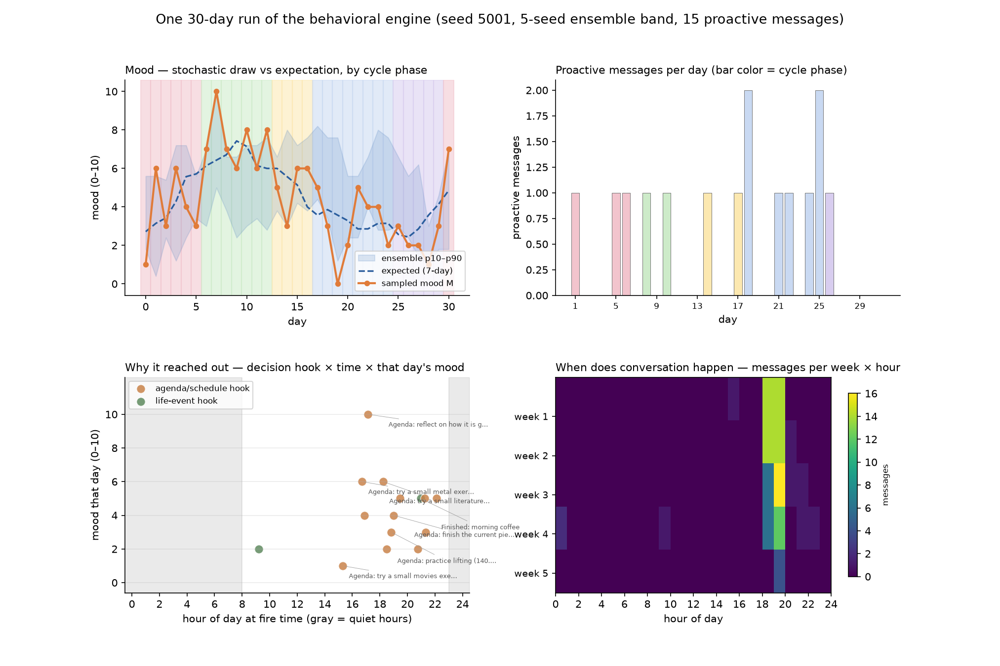

*One 30-day engine run (seed 5001): sampled mood against its 7-day expectation
over cycle phases with a 5-seed band, proactive messages per day by phase, each
proactive decision at its fire hour with its hook text, and when conversation
happens. Data: `results/it3-backfill-2026-08-09`.*

## How it works

- **Seeded engine, model renders.** `engine/` owns timing, opportunity windows
  and affect state. The model only decides whether and how to act within them,
  and every decision is stored with a replay id.
- **Briefs, never numbers.** State reaches the prompt as natural-language
  briefs. A forbidden-token test battery checks that no numeric state leaks.
- **The judge is an instrument.** It sits inside the system's only closed loop,
  so it gets an estimated neutral point, an anchored temperature-0 rubric,
  test-retest checks and documented recalibration.
- **Replayable.** Every stochastic step and model call is stored with its seed
  and a repro bundle; seed-keyed replays are byte-identical across resume.

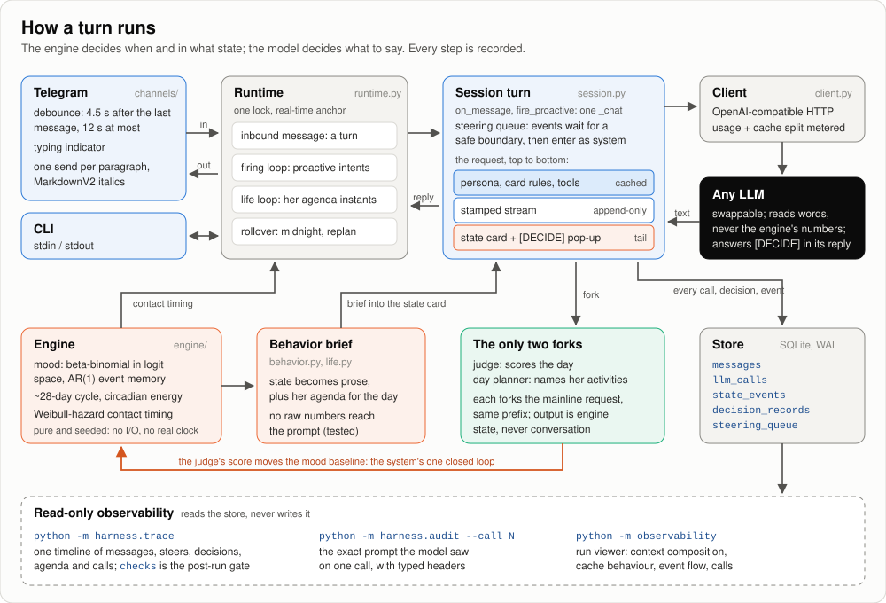

```
engine/       mood (beta-binomial in logit space, AR(1) event memory), ~28-day
              cycle, circadian energy, Weibull-hazard contact timing, seeded RNG
harness/      prompt assembly, steering, scheduling, judge, memory, negotiation,
              proactive decisions, spend ledger, SQLite store
experiments/  experiment drivers and reproducibility helpers
```

The store is one SQLite file (WAL, additive migrations). `state_events` and
`llm_calls` are append-only, so the exact prompt of any call can be rebuilt.

Voice calls ride the same session. When he calls, she decides whether to pick
up inside her own turn; answered, a local voice client streams her reply
sentence by sentence, and only what he actually heard is stored as her line.

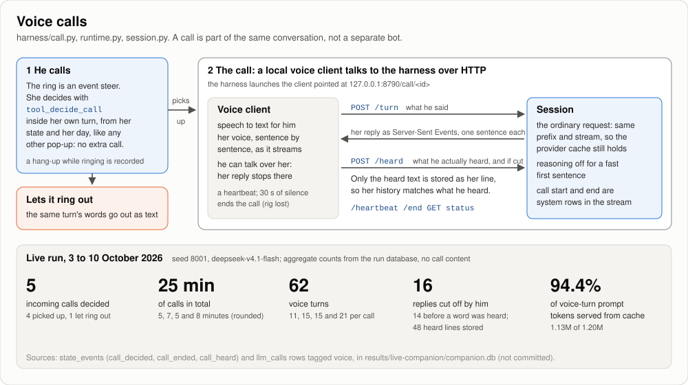

## Results

### The current live run

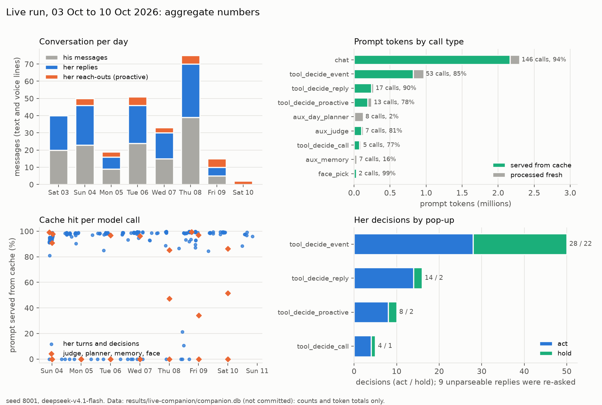

*Seed 8001, deepseek-v4.1-flash, 3 to 10 October 2026; counts and token totals
only. 87% of all prompt tokens were served from the provider's cache, and most
of her turns and decisions sit above 90%. The 30 calls near 0% are real: half
came after more than an hour of quiet, the rest within a minute of another
call.*

### The live run, day by day

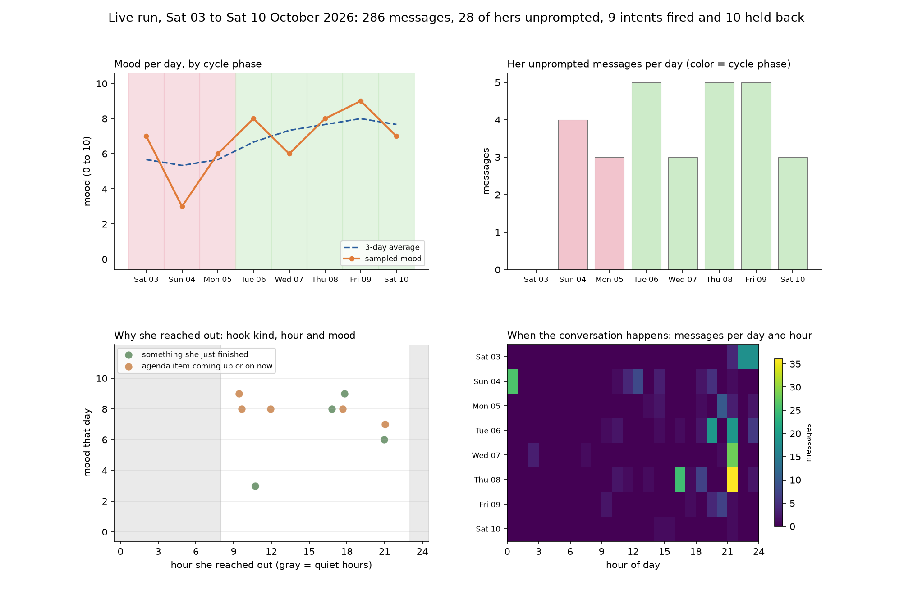

*Same run, 3 to 10 October 2026, in real time. Mood is sampled once a day and
shaded by cycle phase; her unprompted messages follow it. Every reach-out came
from something on her own agenda: an item starting or one she just finished.
Hook text is not drawn, since in a live run it quotes real plans. Rendered by
[`scripts/live_run_figures.py`](scripts/live_run_figures.py).*

<details>
<summary>Who writes when, and what happens to her intents</summary>

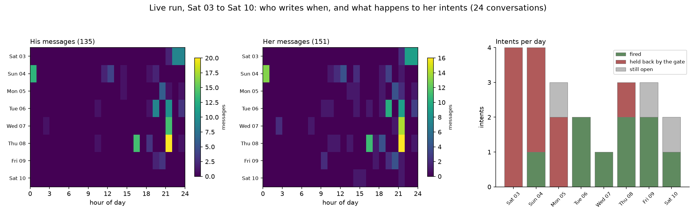

*His messages against hers by hour, and her intents per day. In the first two
days the gate held back 7 of 8; once the conversation had a rhythm, most fired.
An earlier accelerated two-week run against a scripted user is in
[`results/two-week-live-run-report.md`](results/two-week-live-run-report.md).*

</details>

### The judge, measured

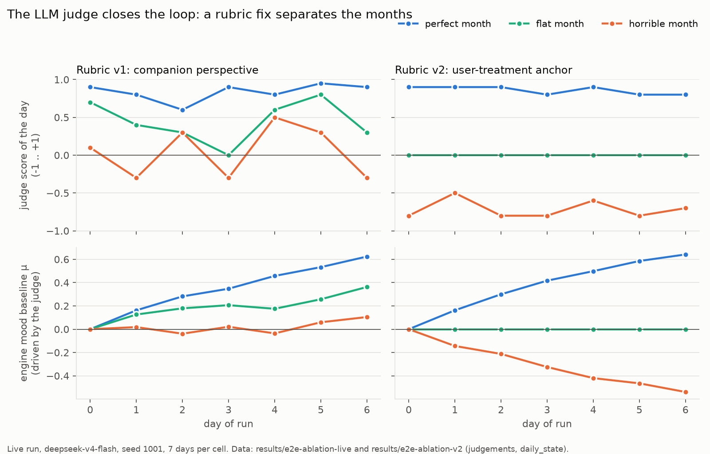

*Live 3x2 ablation (deepseek-v4-flash, seed 1001, 7 days, harness-on cells).
Rubric v1 scored the horrible month near zero and let the flat month drift
positive, so the horrible month's mood baseline never went negative (it ended
at +0.10). Rubric v2 anchors on how the user treats her: the flat month sits at
0.00 and the baseline splits to +0.64 / 0.00 / -0.54. Write-up:
[`results/e2e-ablation-v1-v2-comparison.md`](results/e2e-ablation-v1-v2-comparison.md).*

### The decision protocol, probed

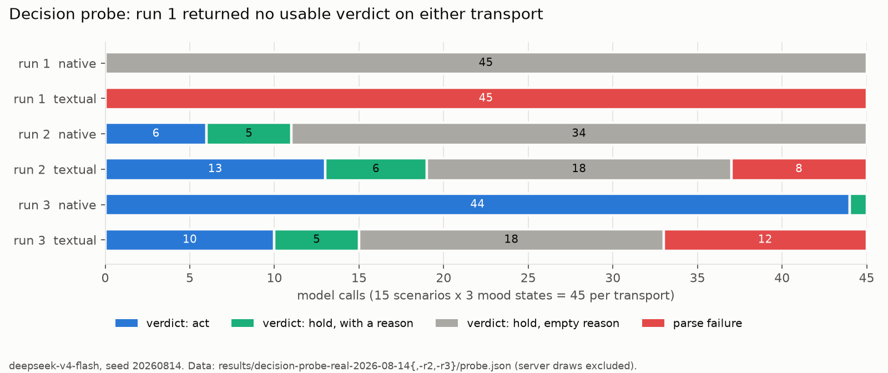

*Three real decision-probe runs (deepseek-v4-flash, 15 scenarios x 3 mood
states x 2 transports). In run 1 every native tool call echoed the event fields
instead of a verdict, which reads as "hold" with an empty reason, and every
textual reply failed to parse. Server draws are left out.*

### Ablations and null results

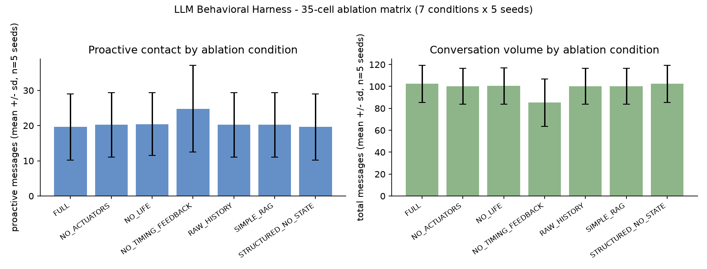

*Proactive contact and conversation volume across 7 conditions x 5 seeds.
Removing the timing-feedback channel changes proactive behavior; removing
internal state does not, a negative result reported with controls.*

Null results stay recorded as nulls: the affect-codebook classifier landed at
chance (~0.31 against 0.33) with a passing control to rule out instrument
failure, and the Spike2 behavioral-eval machinery was shelved with a decision
memo.

<details>
<summary>One simulated week at engine granularity</summary>

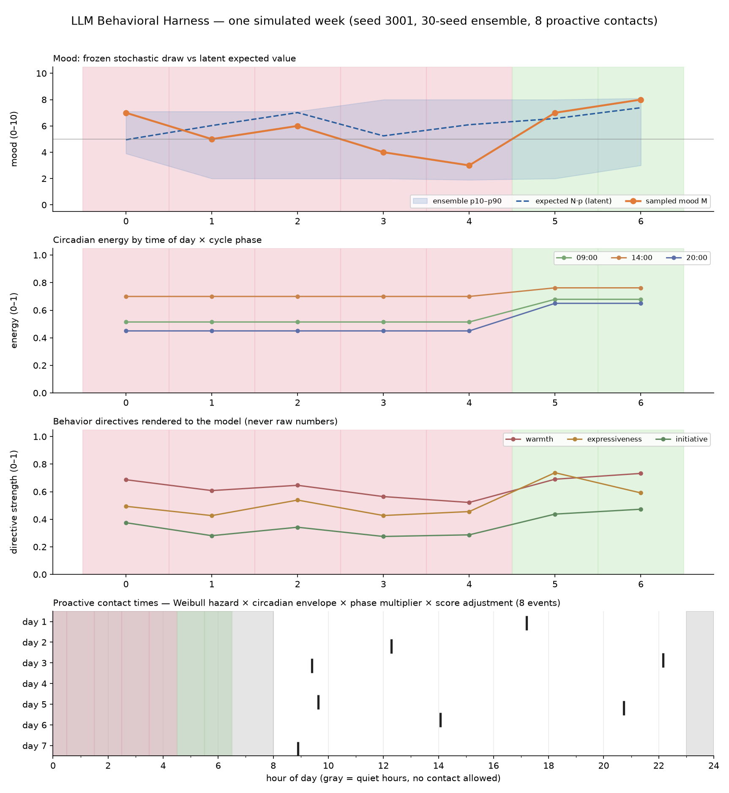

*Circadian energy by time of day and phase, and the prose briefs those states
render into.*

</details>

### Evidence index

| Record | What it shows |
|---|---|
| [Preregistered 8-criterion study](results/phase-1-report.md) | 5 waves, 10-seed verification, PASS/FAIL per criterion |
| [35-cell ablation matrix](results/it2-g6-matrix/traces.md) | 7 conditions x 5 seeds, each ablating exactly one channel |
| [Horizon-split reconciliation](results/it3-g2-horizon-split-reconciliation-2026-08-10.md) | A gate that passed while the mechanism did not work, with corpus receipts |
| [Decision probes r1 to r3](results/decision-probe-real-2026-08-14-r3/) | 90 real model calls per run; silent tool-protocol failures |
| [30-day behavior showcase](results/behavior-showcase/) | Reproducible emulation: mood trajectories, phase semantics, traces |

## Inspecting a run

Every run can be read without writing a query:

```bash
python -m harness.trace --db results/live-companion/companion.db          # timeline
python -m harness.trace --db results/live-companion/companion.db checks   # invariants
python -m harness.audit --store results/live-companion/companion.db --call 12
```

`trace` merges messages, steers, decisions, negotiations, agenda boundaries and
provider calls into one stream on the real local clock. Its `checks` view
asserts the run's invariants (a decision offered and never answered, a prefix
re-sent but not cached, an unmetered model lane, a skipped activity reported as
done) and exits 1 on any error, so it is the post-run gate. `audit` renders the
exact prompt of one call.

`python -m observability` serves the same data as a run viewer:

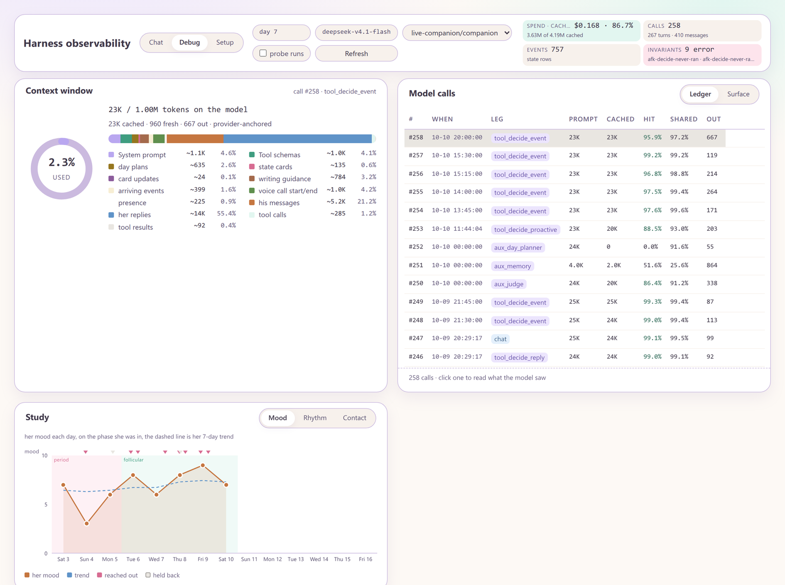

*The viewer on the live run. Panels that show message or prompt text are left
out of this screenshot.*

## Reproducing

Commands run inside the project virtualenv (`.venv/bin/python`).

| What | Command |
|---|---|
| 30-day emulation, no network | `MPLBACKEND=Agg python -m experiments.behavior_showcase` |
| Month figure | `python -m experiments.month_showcase` |
| Week figure | `python -m experiments.week_showcase` |
| Two-week live figures | `python -m experiments.live_two_weeks_figures` |
| Judge, probe and live-run charts | `MPLBACKEND=Agg python scripts/readme_charts.py` (live run needs its local database) |
| Test suite | `MPLBACKEND=Agg python -m pytest -q` |

## Limitations

A solo project, mostly on one model. The live ablation has one seed per cell,
so it is directional, not inferential. Blind human rating is the recommended
next step.

## Further reading

- [`DESIGN.md`](DESIGN.md): the engine's mathematics and parameters.
- [`docs/architecture-overview.md`](docs/architecture-overview.md): the current
  runtime and context contract.
